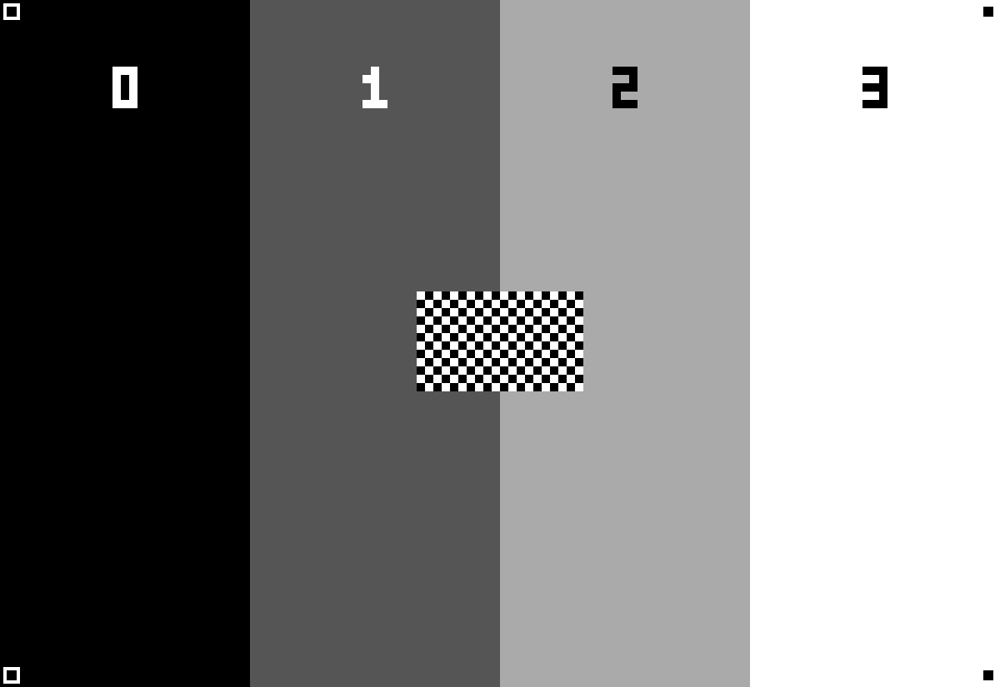

# HomePlate Development Guide

This guide covers building, flashing, and debugging HomePlate using [PlatformIO](https://platformio.org/). For general installation and setup, see the [README](README.md) and [Setup Guide](setup.md).

## Container development

Use Docker for development, dependencies, and tests. The wrapper builds the
development image and stores PlatformIO toolchains in the shared
`homeplate-platformio` Docker volume. It supports both normal clones and the
bare-repository worktree layout; the common Git directory is mounted read-only
so firmware version detection works inside the container.

```shell
sh scripts/dev pio test -e native
sh scripts/dev pio run -e inkplate10v2
sh scripts/dev pio run  # build all default board environments
```

Run the PlatformIO commands below through `sh scripts/dev` as well. Project
dependencies are installed in the container, with build output under `.pio/`.
USB device passthrough depends on the Docker host; a compiled `firmware.bin` can
also be uploaded through the existing device's setup portal.

## Experimental Inkplate 10 v2 four-gray image updates

On this branch, the `inkplate10v2` environment uses the pinned FastEPD library for
whole-image updates. The existing PNG/BMP/JPEG decoder renders its usual eight
gray levels, then they are quantized to four: black, dark gray, light gray, and
white. Each image is sent with `fullUpdate(CLEAR_NONE, false)`, without a
black/white clearing cycle or a comparison against the previous image. This
also works after deep sleep without saving the previous framebuffer.

FastEPD handles the parallel pixel transfers. Its custom panel callbacks use
Inkplate's existing PMIC, factory VCOM, and shared expander state. The LCD bus is
released after each image update so the normal Inkplate drawing path can still
show other activities. Progress text is logged to serial instead of being
painted over an image. Failed decodes never send an incomplete image to FastEPD.

This is an experiment for the Inkplate 10 **v2** only. Other board environments
use their existing drivers. Non-image screens, startup, and low-battery overlays
still use the existing refresh behavior and may flash. Gray pixels can visibly
transition through intermediate colors even without a whole-screen clearing
flash. Repeated no-clear updates may cause ghosting or reduced contrast; show
the Info activity to perform a normal clearing refresh when needed. No automatic
clearing interval is added by this experiment.

### Hardware verification

```shell
sh scripts/dev python scripts/gray4-test-images.py
```

The command produces two 1200x825 PNGs in `.pio/gray4-test/`. Host these images at
URLs reachable by the Inkplate and display them using the existing MQTT Image
URL action, or use equivalent dashboard images.

Expected test pattern (this is a generated reference, not a panel photograph):



1. Flash `.pio/build/inkplate10v2/firmware.bin` onto an Inkplate 10 v2. Confirm the
   serial log reports `FastEPD four-gray backend: ready` and a successful
   `CLEAR_NONE` update.
2. Display `shades.png`: expect four distinct vertical shades, digits 0–3 from
   left to right, a centered checkerboard, and all four corner markers. Confirm
   the image is neither mirrored nor cropped.
3. Alternate `shades.png` and `shades-inverted.png`: expect both light-to-dark
   and dark-to-light transitions without a whole-screen black/white wipe.
4. Repeat at least 20 times and record ghosting and contrast. Switch to Info,
   then return to the test images; expect a clean image and working refreshes.
5. Repeat across timer deep-sleep wakes and in always-on mode. Confirm images,
   battery/temperature reporting, RTC, and the wake button still work.
6. Request a malformed image: expect a decode failure in the serial log, no
   FastEPD frame submission, and the previous image retained.

Native tests and compilation cannot establish visual quality, flicker, power
sequencing on the physical board, or long-term ghosting. These hardware checks
must be completed before treating this backend as verified.

## Building

Build for your board variant with PlatformIO in the container:

```shell
pio run -e inkplate5       # Inkplate 5
pio run -e inkplate5v2     # Inkplate 5v2
pio run -e inkplate10      # Inkplate 10 (original with touchpads)
pio run -e inkplate10v2    # Inkplate 10v2 (without touchpads)
pio run -e inkplate6       # Inkplate 6 (original with touchpads)
pio run -e inkplate6v2     # Inkplate 6v2 (without touchpads)
pio run -e inkplate6plus   # Inkplate 6 Plus
pio run -e inkplate6plusv2 # Inkplate 6 Plus v2
pio run -e inkplate6flick  # Inkplate 6 Flick
pio run -e inkplate6color  # Inkplate 6 COLOR (7-color ACeP panel)
pio run -e inkplate13spectra # Inkplate 13 Spectra (13.3" 6-color Spectra panel, ESP32-S3)
```

> **Note:** Running `pio run` without `-e` builds all supported Inkplate board variants (the special-purpose `ota`, `debug`, `vcom`, `waveform_eeprom`, and `native` envs are excluded from the default set and must be invoked explicitly with `-e <env>`). `pio run` only compiles — it will not upload to a connected device. To flash, see the next section.

## Flashing via USB

The first flash must be done over USB. Connect your Inkplate via USB and run:

```shell
pio run -e inkplate10 -t upload -t monitor  # build, flash, and open serial monitor
```

Replace `inkplate10` with your board variant. The `-t upload -t monitor` flags chain the upload and serial monitor steps so they run together in one command. Drop `-t monitor` if you don't want to attach the serial monitor afterward.

## Flashing via OTA (PlatformIO)

After the initial USB flash, you can update over WiFi using PlatformIO OTA. First, set your board in the `[user]` section of `platformio.ini` (see [Selecting your board for special-purpose envs](#selecting-your-board-for-special-purpose-envs) below) and edit `[env:ota]` to set your device hostname/IP, then run:

```shell
pio run -e ota
```

> **Note:** OTA must be enabled on the device (see the **Enable OTA** setting in [setup.md](setup.md#display--ota)), and the device must be awake (not sleeping) when you initiate the OTA flash. With [Always On](setup.md#always-on) enabled the device is always reachable, so there is no wake window to catch.

## Selecting your board for special-purpose envs

The default board envs (`[env:inkplate5]`, `[env:inkplate10]`, etc.) are self-contained and need no configuration — just pick the one matching your hardware: `pio run -e inkplate10 -t upload -t monitor`.

The **special-purpose envs** — `debug`, `ota`, `vcom`, and `waveform_eeprom` — are board-agnostic and read their target board from a `[user]` section near the top of [platformio.ini](platformio.ini). If you only ever build the regular `inkplate*` envs, you can ignore this section entirely. If you want to use any of the special-purpose envs, set `board_flag` to match your hardware:

```ini
[user]
board_flag = -DARDUINO_INKPLATE10
```

`board_flag` values for each variant:

| Board               | `board_flag`                   |
|---------------------|--------------------------------|
| `inkplate5`         | `-DARDUINO_INKPLATE5`          |
| `inkplate5v2`       | `-DARDUINO_INKPLATE5V2`        |
| `inkplate6`         | `-DARDUINO_INKPLATE6`          |
| `inkplate6v2`       | `-DARDUINO_INKPLATE6V2`        |
| `inkplate6plus`     | `-DARDUINO_INKPLATE6PLUS`      |
| `inkplate6plusv2`   | `-DARDUINO_INKPLATE6PLUSV2`    |
| `inkplate6flick`    | `-DARDUINO_INKPLATE6FLICK`     |
| `inkplate10`        | `-DARDUINO_INKPLATE10`         |
| `inkplate10v2`      | `-DARDUINO_INKPLATE10V2`       |
| `inkplate6color`    | `-DARDUINO_INKPLATECOLOR`      |
| `inkplate13spectra` | `-DARDUINO_INKPLATE13SPECTRA`  |

This setting only affects the four special-purpose envs above. The default board envs and CI builds are unaffected.

> **Note:** The special-purpose envs assume the classic-ESP32 boards (`board = esp32dev`). The Inkplate 13 Spectra is ESP32-S3 based, so to use a special-purpose env with it you must also copy the `board` and `board_build.partitions` lines from `[env:inkplate13spectra]` into that env and change its build flags to use `${inkplate_defaults.build_flags_common}` (the classic envs' `-mfix-esp32-psram-cache-issue` flag does not apply to the S3).

## Serial Monitoring

To monitor serial output without re-flashing:

```shell
pio device monitor
```

## Updating PlatformIO & Dependencies

After pulling new changes, update your PlatformIO environment:

```shell
git pull
pio upgrade
pio pkg update
pio run --target clean
```

## Resetting All Settings

To clear all saved settings and start fresh, erase the flash before re-flashing:

```shell
pio run -e <board> --target erase
pio run -e <board>
```

> **Tip:** A first-time install via the [Web Installer](https://lanrat.github.io/homeplate/) also erases all settings.

## Debugging

### Touchpad Sensitivity

On some devices, the touchpads can be overly sensitive. This can cause lots of phantom touch events preventing the HomePlate from going into sleep and using up a lot of power.

Sometimes running `pio run --target=clean` can resolve this before you build & flash the firmware.

The touchpad sensitivity is set in hardware by resistors, but the touch sensors are calibrated on bootup when the device first gets power. I have found that USB power can mess with this calibration. If you are using battery power, restarting the HomePlate (by using the power switch on the side of the PCB) without USB power attached is enough to fix the sensitivity.

Alternatively, the touchpads can be completely disabled by adding `#define TOUCHPAD_ENABLE false` in a `src/config.h` file (this is a compile-time only setting and cannot be changed via the WiFi portal). Touchpads are automatically disabled when building for boards without touchpads.

### Waveform

If you get the following error while booting your Inkplate, run the [Inkplate_Wavefrom_EEPROM_Programming](https://github.com/SolderedElectronics/Inkplate-Arduino-library/tree/master/examples/Inkplate10/Diagnostics/Inkplate10_Wavefrom_EEPROM_Programming) example to update your Inkplate's waveform.

```text
Waveform load failed! Upload new waveform in EEPROM. Using default waveform.
```

Older Inkplates don't appear to ship with an updated waveform. I found waveform 5 looks the best for mine.

## Tests

The available unit tests use the 'native' environment and can be run by either:

* running them manually

```shell
sh scripts/dev pio test -e native -v
```

* in VSCode use Testing -> native -> Run Test
* in VSCode use PlatformIO -> Project Tasks -> native -> Advanced -> Test

## Advanced: Compile-Time Configuration

For advanced users, you can optionally create a `src/config.h` file to set compile-time defaults. These values are used as fallbacks when NVS has no saved value. Any setting configured through the WiFi portal will override compile-time defaults.

### Compile-time only settings

Some settings can only be changed at compile time:

| Setting           | Description                                                             |
|-------------------|-------------------------------------------------------------------------|
| `TOUCHPAD_ENABLE` | Enable/disable touchpads (must be `false` for boards without touchpads) |
| `CONFIG_CPP`      | Enable custom sleep schedules via `config.cpp`                          |

### Variable sleep intervals

If you want your Inkplate to sleep with different intervals based on time of day, create a `config.h` with `#define CONFIG_CPP` and implement `sleepSchedule[]` in `config.cpp` (see `config_example.cpp` for reference).
